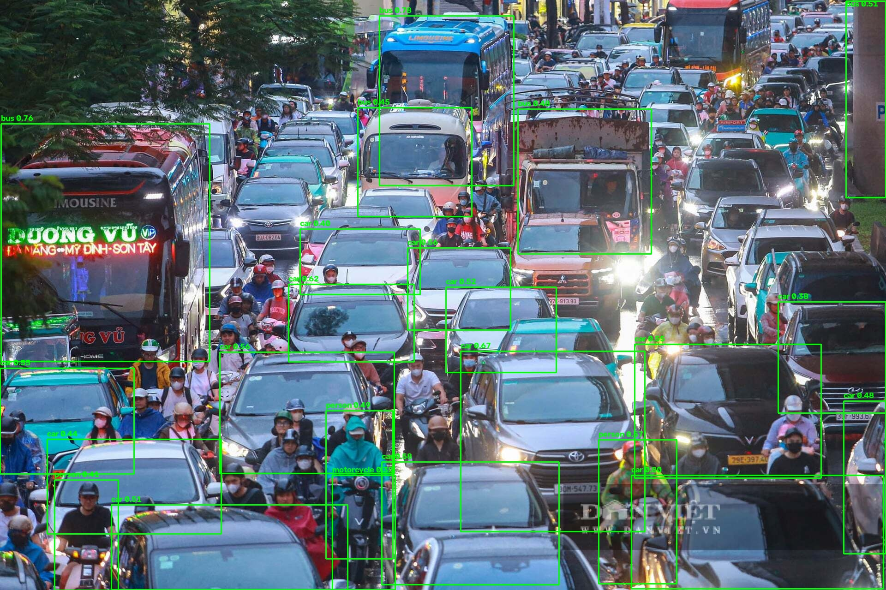
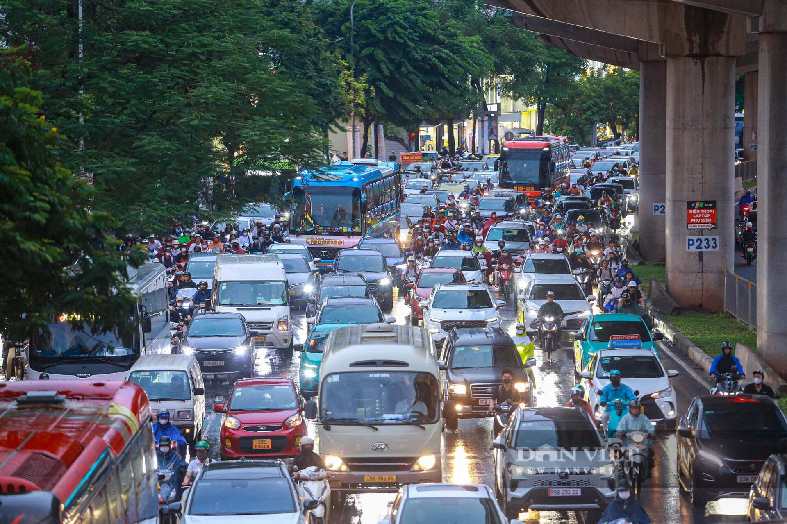
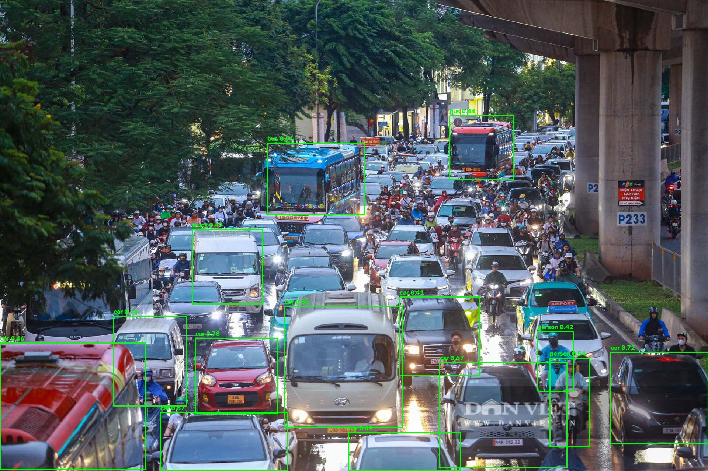

# VNVehicleAI — Nhận diện đối tượng giao thông trên ảnh

Research project — Nhận diện phương tiện giao thông trên **ảnh** (ưu tiên), hỗ trợ thêm pipeline video tracking. Hệ thống cung cấp **2 backend** với hai triết lý kiến trúc khác nhau, kèm module tăng sáng ban đêm và (tùy chọn) tracking + temporal fusion.

## 1. Tổng quan (Overview)

Dự án giải quyết bài toán **Object Detection** (phát hiện đối tượng) trong miền giao thông đường bộ, với hai hướng tiếp cận song song:

| Backend | Kiến trúc | Triết lý |
| --- | --- | --- |
| **YOLO11** (ultralytics) | Anchor-free CNN detector — backbone C3k2 + C2PSA, neck PANet, decoupled head | **Khuyến nghị** — hội tụ nhanh (vài epoch), chất lượng cao |
| **DETR-style** (PyTorch tự viết) | Transformer-based detector — ResNet backbone + Transformer Encoder/Decoder + object queries | **Nghiên cứu** — hội tụ chậm (hàng trăm epoch), kiến trúc tham khảo |

Điểm khác biệt cốt lõi giữa hai backend:

- **YOLO** dùng grid-based prediction với target assignment dựa trên IoU → học nhanh vì có prior không gian.
- **DETR** dùng bipartite matching (Hungarian algorithm) giữa dự đoán và ground truth → phải học cả object queries lẫn cách gán cặp, nên cần nhiều epoch hơn.

## 2. Tính năng (Features)

- Nhận diện **ảnh đơn lẻ** hoặc **cả thư mục** — xuất ảnh có bounding box + JSON kết quả.
- Tự phát hiện backend từ checkpoint (`--backend auto`): DETR hay YOLO.
- Tăng sáng trước khi detect (low-light enhancement): `auto / clahe / gamma / retinex / night / none`.
- (Tùy chọn) Video tracking:
  - **Kalman 8D + Hungarian** — tương đương SORT.
  - **ByteTrack two-stage** — giữ cả low-confidence detection ở giai đoạn hai, giảm ID switch.
- (Tùy chọn) **Temporal fusion** theo Track ID — hợp nhất dự đoán qua nhiều frame, giảm flicker.

## 3. Hai backend — So sánh chi tiết

| Tiêu chí | YOLO11 | DETR-style |
| --- | --- | --- |
| Cài đặt | `ultralytics` (thư viện ngoài) | PyTorch thuần (trong repo) |
| Số lớp | **7** (Thai) | **9** |
| Tên lớp | car, bus, taxi, bike, pickup, truck, trailer | person, bicycle, car, motorbike, bus, taxi, pickup, truck, trailer |
| Hội tụ | Nhanh (vài epoch) | Chậm (cần hàng trăm epoch) |
| Trạng thái | **Khuyến nghị** | Tham khảo / nghiên cứu |

> **Lưu ý quan trọng:** DETR 9 lớp dùng `data.class_map` để ánh xạ 7 lớp Thai vào chỉ số 2–8. Hai lớp `person` / `bicycle` **chưa có dữ liệu huấn luyện**.

**Khái niệm class_map (label remapping):** khi fine-tuning checkpoint có số lớp khác dataset, cần bảng ánh xạ chỉ số lớp. Ví dụ `{0:2, 1:4, 2:5, 3:3, 4:6, 5:7, 6:8}` chuyển lớp YOLO (0–6) sang chỉ số lớp DETR (2–8).

## 4. Cấu trúc thư mục (Project Structure)

```text
configs/
  thai_yolo.yaml          # YOLO 7 lớp (Thai) — dùng cho nhận diện ảnh
  thai_9class.yaml        # DETR 9 lớp trên dữ liệu Thai (class_map 7->9)
  default.yaml            # DETR cấu hình đầy đủ (9 lớp)
  low_vram.yaml           # DETR nhẹ cho GPU 4GB
  demo_synthetic.yaml     # DETR demo synthetic (tiny backbone)

src/vnplate/
  config.py               # config loader
  data/
    taxonomy.py           # định nghĩa lớp đối tượng (VEHICLE_CLASSES)
    lowlight.py           # tăng sáng (auto/clahe/gamma/retinex/night)
    yolo.py               # YOLO-format dataset loader (hỗ trợ class_map)
    factory.py            # build_detection_dataset (YOLO -> synthetic fallback)
    synthetic.py          # dữ liệu tổng hợp + video demo
    transforms.py         # resize, normalize, box conversion
  models/                 # DETR: backbone, transformer, detector, matcher, box_ops
  tracking/               # kalman, association, tracker (SORT/ByteTrack)
  fusion/temporal.py      # temporal fusion
  pipeline/video_pipeline.py  # pipeline video (low-light + tracking)
  engine/
    train_detector.py     # huấn luyện DETR
    evaluate.py           # detection / tracking metrics

scripts/
  detect.py               # nhận diện ảnh (DETR hoặc YOLO)
  train_yolo_baseline.py  # huấn luyện YOLO11
  train_detector.py       # huấn luyện DETR
  eval.py                 # đánh giá DETR
  run_video.py            # pipeline video (tùy chọn)
  make_demo.py            # sinh video synthetic
  smoke_test.py           # kiểm tra module
  download_thai_dataset.py

tests/                    # pytest
```

## 5. Cài đặt (Installation)

```bash
conda env create -f environment.yml
conda activate vnplate

# PyTorch CUDA (RTX 3050 / CUDA 12.4)
pip install torch torchvision --index-url https://download.pytorch.org/whl/cu124
pip install ultralytics          # cho backend YOLO
pip install -e .
```

## 6. Dataset — Thai Vehicle (7 lớp)

```bash
python scripts/download_thai_dataset.py --root data/vehicles
```

Layout YOLO-format:

```text
data/vehicles/<dataset>/train/images/*.jpg
data/vehicles/<dataset>/train/labels/*.txt
data/vehicles/<dataset>/valid/images/*.jpg
data/vehicles/<dataset>/valid/labels/*.txt
```

Phân bố lớp (train, ~24k bounding box):

| Lớp | Số box |
| --- | --- |
| car | 8,709 |
| pickup | 5,061 |
| bus | 3,911 |
| bike | 2,217 |
| truck | 1,984 |
| taxi | 1,257 |
| trailer | 914 |

`configs/thai_yolo.yaml` khai báo đúng 7 lớp cho backend YOLO.

`configs/thai_9class.yaml` dùng `data.class_map: {0:2, 1:4, 2:5, 3:3, 4:6, 5:7, 6:8}` cho DETR 9 lớp.

## 7. Quickstart — Nhận diện ảnh (Image Detection)

### 7.1 Với YOLO (khuyến nghị)

```bash
# 1 ảnh
python scripts/detect.py --config configs/thai_yolo.yaml \
  --input data_test/anh.jpg \
  --detector runs/detect/runs/baseline/yolo11n_thai/weights/best.pt \
  --output demo/anh_detected.jpg --conf-threshold 0.25

# cả thư mục
python scripts/detect.py --config configs/thai_yolo.yaml \
  --input data_test \
  --detector runs/detect/runs/baseline/yolo11n_thai/weights/best.pt \
  --output demo/yolo_detected --conf-threshold 0.2
```

### 7.2 Với DETR

```bash
python scripts/detect.py --config configs/thai_9class.yaml \
  --input data_test/anh.jpg \
  --detector checkpoints/detector_best.pt \
  --result-json demo/detr_result.json
```

**Backend auto-detection:** script tự phát hiện backend từ checkpoint. Có thể ép bằng `--backend yolo` hoặc `--backend detr`.

### 7.3 Ảnh tối / ban đêm (Low-light Enhancement)

```bash
python scripts/detect.py --config configs/thai_yolo.yaml \
  --input data_test/anh_4.jpg \
  --detector runs/detect/runs/baseline/yolo11n_thai/weights/best.pt \
  --low-light-mode clahe      # hoặc --night
```

Các chế độ enhancement (`src/vnplate/data/lowlight.py`):

| Chế độ | Thuật ngữ đầy đủ | Tác dụng |
| --- | --- | --- |
| `clahe` | CLAHE — Contrast Limited Adaptive Histogram Equalization | Cân bằng histogram thích nghi, tăng tương phản vùng tối |
| `gamma` | Gamma Correction | Nâng sáng phi tuyến |
| `retinex` | Retinex | Tách thành phần illumination / reflectance |
| `auto` / `night` / `none` | — | Tự động / preset ban đêm / không xử lý |

Enhancement chạy **trước backbone** → không ảnh hưởng kiến trúc YOLO11, chỉ thay đổi phân phối pixel đầu vào.

Output JSON: danh sách `box` (xyxy), `score`, `label`.

## 8. Demo trên ảnh thực tế (Real-world Demo)

Ảnh đường phố trong `data_test/`, nhận diện bằng YOLO pretrained COCO (`yolo11n.pt`):

| Ảnh gốc | Sau nhận diện |
| --- | --- |
|  |  |
|  |  |

Ảnh trực tiếp:


| Demo | Kết quả |
| --- | --- |
| Demo 1 | **23** đối tượng — car 14, bus 5, person 3, motorcycle 1 |
| Demo 2 | **14** đối tượng — car 9, bus 2, person 2, truck 1 |

```bash
python scripts/detect.py --config configs/thai_yolo.yaml \
  --input data_test/anh.jpg --detector yolo11n.pt \
  --output assets/test_anh_detected.jpg --conf-threshold 0.35
```

> ⚠️ **Domain Gap:** model huấn luyện trên dữ liệu Thai có domain gap với ảnh ngoài miền (confidence thấp). Demo dùng COCO pretrained thay vì model tự huấn luyện. Để model tự huấn luyện bắt tốt ảnh thực tế, cần bổ sung ảnh cùng miền vào training set — đây là **domain adaptation bằng dữ liệu**.

## 9. Huấn luyện (Training)

### 9.1 YOLO11 (khuyến nghị)

```bash
python scripts/train_yolo_baseline.py \
  --model yolo11n.pt --data configs/thai_yolo.yaml \
  --epochs 50 --imgsz 640 --batch 4 --device 0 --workers 4 \
  --name yolo11n_thai
```

Trọng số: `runs/detect/runs/baseline/yolo11n_thai/weights/best.pt`

Script tự chạy validation và in mAP cuối.

**Resume** nếu training bị ngắt (dùng `last.pt`, đọc lại args đã lưu):

```bash
python scripts/train_yolo_baseline.py --resume \
  --model runs/detect/runs/baseline/yolo11n_thai/weights/last.pt
```

**Khái niệm checkpoint:**

- `best.pt` — trọng số tốt nhất theo validation metric.
- `last.pt` — trọng số epoch cuối, kèm optimizer state, scheduler state, epoch counter → cần thiết để resume liền mạch.

Hiệu năng trên RTX 3050 4GB: ~2.5 phút/epoch → 50 epoch ~2.5 giờ. Có thể giảm `--epochs`, `--imgsz` để nhanh hơn (đây là các hyperparameter ảnh hưởng trực tiếp đến GPU memory footprint).

### 9.2 DETR

```bash
python scripts/train_detector.py --config configs/thai_9class.yaml

# chạy thử nhanh
python scripts/train_detector.py --config configs/thai_9class.yaml --steps 50
```

## 10. Đánh giá (Evaluation)

```bash
# DETR trên tập validation, thử nhiều ngưỡng confidence
python scripts/eval.py --config configs/thai_9class.yaml --split val \
  --detector checkpoints/detector_best.pt --max-batches 50 \
  --conf-threshold 0.3 0.5 0.6
```

YOLO tự đánh giá sau khi train: `FINAL mAP50-95=... mAP50=...`

Bộ chỉ số đánh giá chuẩn:

- **Precision** = TP / (TP + FP) — trong các box dự đoán dương, bao nhiêu đúng.
- **Recall** = TP / (TP + FN) — trong các đối tượng thật, bắt được bao nhiêu.
- **mAP50** — AP trung bình tại IoU threshold = 0.5.
- **mAP50-95** — AP trung bình trên IoU 0.5:0.95 (khó hơn, chỉ số chính).
- **mAP75** — AP tại IoU threshold = 0.75 (yêu cầu định vị chính xác hơn).

## 11. Kết quả thực nghiệm (Experimental Results)

### 11.1 YOLO11n trên Thai (val) — `best.pt` (epoch 30/50)

Tổng hợp:

| Metric | Giá trị |
| --- | --- |
| **mAP50** | **0.809** |
| **mAP50-95** | **0.549** |
| mAP75 | 0.635 |

Chi tiết theo lớp:

| Class | P | R | mAP50 | mAP50-95 |
| --- | --- | --- | --- | --- |
| car | 0.757 | 0.689 | 0.794 | 0.521 |
| bus | 0.918 | 0.831 | 0.916 | 0.694 |
| taxi | 0.754 | 0.800 | 0.848 | 0.573 |
| bike | 0.712 | 0.791 | 0.784 | 0.382 |
| pickup | 0.650 | 0.655 | 0.713 | 0.486 |
| truck | 0.823 | 0.781 | 0.862 | 0.613 |
| trailer | 0.711 | 0.667 | 0.745 | 0.571 |

Training dừng ở ~epoch 32/50 (early stopping, best ở epoch 30). Có thể resume bằng `--resume`.

Tham khảo: sau 3 epoch đạt **mAP50 0.652 / mAP50-95 0.421** — YOLO đã vượt xa DETR (F1 ~0.35 sau 14 epoch).

### 11.2 DETR (Thai, 14 epoch)

| Conf | Precision | Recall | F1 |
| --- | --- | --- | --- |
| 0.30 | 0.131 | 0.551 | 0.212 |
| 0.50 | 0.231 | 0.406 | 0.295 |
| 0.60 | 0.329 | 0.377 | 0.351 |

### 11.3 Nhận xét (Analysis)

- **YOLO vượt trội** về tốc độ hội tụ và độ chính xác trên dữ liệu thật (mAP50 0.81 sau ~30 epoch).
- **DETR** cần hàng trăm epoch; hiện chưa hội tụ (đúng đặc điểm kiến trúc transformer-based).
- **Domain gap:** trên ảnh `data_test` (ngoài miền Thai), `best.pt` chỉ cho ~6 detection ở conf 0.25 → cần bổ sung ảnh cùng miền vào train để cải thiện.

## 12. (Tùy chọn) Video + Tracking

```bash
python scripts/run_video.py --config configs/thai_9class.yaml \
  --video path/to/input.mp4 --detector checkpoints/detector_best.pt \
  --output demo/output.mp4 --result-json demo/results.json

# ban đêm + ByteTrack
python scripts/run_video.py --config configs/thai_9class.yaml \
  --video input.mp4 --detector checkpoints/detector_best.pt \
  --night --byte-track --output demo/output_night.mp4
```

Pipeline video: `detect → track → temporal fusion`. `run_video.py` dùng backend DETR.

**Khái niệm tracking:**

- **Kalman 8D + Hungarian** — tương đương SORT: Kalman dự đoán trạng thái 8 chiều (x, y, w, h, vx, vy, vw, vh), Hungarian gán cặp detection ↔ track.
- **ByteTrack two-stage** — giữ cả low-confidence detection ở giai đoạn hai → giảm ID switch.
- **Temporal fusion theo Track ID** — hợp nhất dự đoán qua nhiều frame → giảm flicker, tăng recall cho đối tượng bị che khuất tạm thời.

## 13. Kiểm thử (Testing)

```bash
python scripts/smoke_test.py
pytest -q
```

## 14. Ghi chú kỹ thuật (Technical Notes)

| Vấn đề | Giải pháp |
| --- | --- |
| VRAM thấp (4GB) | Giảm `--batch`, `--imgsz`; DETR dùng `backbone: tiny`, giảm `hidden_dim` / `num_queries` |
| DETR hội tụ chậm | Dùng pretrained backbone + AMP (Automatic Mixed Precision) |
| Số lớp phải khớp checkpoint | Checkpoint 7 lớp ≠ 9 lớp — không dùng lẫn |
| Chọn đúng YAML | YOLO dùng `configs/thai_yolo.yaml` (7 lớp); DETR dùng `configs/thai_9class.yaml` (9 lớp + class_map) |

## 15. License

Mã nguồn phục vụ học thuật.

## 16. Tóm tắt bằng một bảng

| Tầng | Chức năng | Cơ chế cốt lõi (thuật ngữ) |
| --- | --- | --- |
| Preprocessing | Chuẩn hóa + tăng sáng | Resize, letterbox, normalization, CLAHE / Gamma / Retinex |
| Backbone (YOLO) | Trích xuất đặc trưng | C3k2 + C2PSA |
| Backbone (DETR) | Trích xuất đặc trưng | ResNet |
| Neck (YOLO) | Hợp nhất đa tỷ lệ | PANet |
| Head (YOLO) | Dự đoán class + box | Decoupled head + depthwise separable conv |
| Head (DETR) | Dự đoán qua object queries | Transformer Encoder/Decoder |
| Loss (YOLO) | Hướng dẫn tối ưu | Box Loss + Cls Loss (BCE) + DFL Loss |
| Loss (DETR) | Hướng dẫn tối ưu | Hungarian matching + bipartite loss |
| Post-processing | Loại box trùng | Confidence threshold + NMS (IoU threshold) |
| Tracking | Theo dõi qua frame | Kalman 8D + Hungarian hoặc ByteTrack |
| Fusion | Hợp nhất temporal | Temporal fusion theo Track ID |
