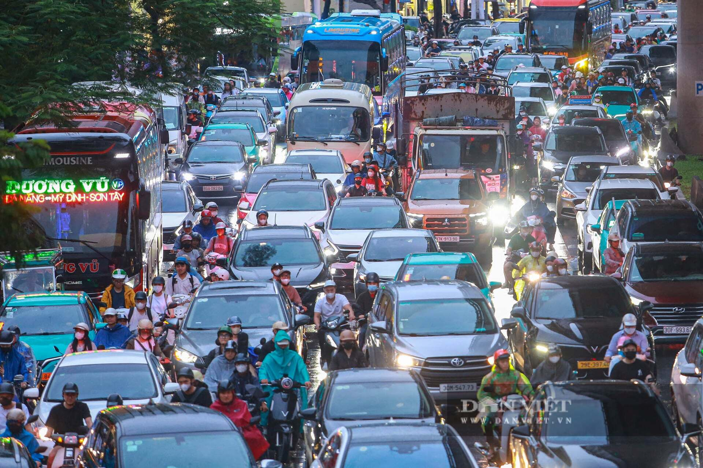
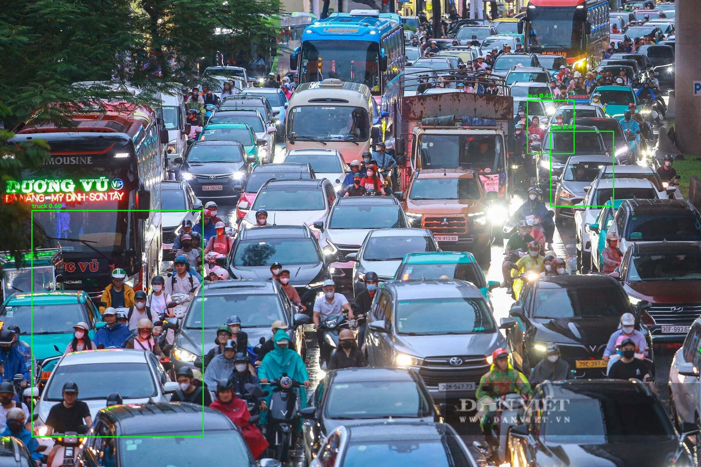

# VNVehicleAI — Multi-frame Vehicle Detection and Tracking

Dự án **Research** tái hiện pipeline đa khung hình cho nhận diện/tracking phương tiện giao thông trong video chất lượng thấp: **detect → track → temporal fusion** trên toàn bộ chuỗi frame.

## Kiến trúc

```
Video frame
   │
   ├─ DETR-style Detector        src/vnplate/models/detector.py
   │     ResNet/Tiny backbone + Transformer Encoder/Decoder + object queries
   │     (num_classes: car, motorbike, bus, truck)
   │
   ├─ Multi-Object Tracking       src/vnplate/tracking/
   │     KalmanBoxFilter (8D: cx,cy,w,h,vx,vy,vw,vh) + Hungarian data association
   │
   └─ Temporal Fusion             src/vnplate/fusion/temporal.py
         Weighted vote theo Track ID
```

`Track ID` (danh tính đối tượng theo thời gian) **khác** với loại phương tiện.

## Cấu trúc thư mục

```
configs/default.yaml          # toàn bộ hyperparameter
configs/low_vram.yaml         # cấu hình nhẹ cho GPU 4GB
src/vnplate/                 # package chính (alias: src/vnvehicle)
  config.py                   # config loader
  data/
    synthetic.py              # dữ liệu tổng hợp + video demo
    transforms.py             # resize, normalize
  models/
    backbone.py               # ResNet18/34/50, Tiny
    transformer.py            # encoder/decoder layers, sine pos-encoding
    detector.py               # DETR-style detector
    matcher.py                # Hungarian matcher + DETR set loss
    box_ops.py                # box conversion + GIoU
  tracking/
    kalman.py                 # Kalman filter 8D
    association.py            # IoU matrix + Hungarian
    tracker.py                # SORT-like multi-object tracker
  fusion/temporal.py          # temporal fusion
  pipeline/video_pipeline.py  # pipeline video end-to-end
  engine/
    train_detector.py
    evaluate.py               # detection / tracking metrics
scripts/                      # CLI
tests/                        # pytest
```

## Công nghệ sử dụng

- **Deep learning:** PyTorch, TorchVision
- **Detection:** DETR-style (ResNet/Tiny backbone + Transformer Encoder/Decoder)
- **Tracking:** Kalman Filter 8D + Hungarian algorithm (scipy)
- **Image/Video:** OpenCV, NumPy
- **Config:** PyYAML
- **Test:** pytest
- **Hardware:** CUDA + AMP (tùy chọn), hỗ trợ CPU

## Cài đặt

```bash
conda env create -f environment.yml
conda activate vnplate
# PyTorch CUDA (RTX 3050 / CUDA 12.4)
pip install torch torchvision --index-url https://download.pytorch.org/whl/cu124
pip install -e .
```

## Quickstart

```bash
# 1) Kiểm tra toàn bộ module chạy được (GPU nếu có)
python scripts/smoke_test.py

# 2) Sinh video demo tổng hợp + annotations
python scripts/make_demo.py --out demo/synthetic.mp4 --frames 90

# 3) Chạy pipeline tracking bằng GT boxes (oracle, không cần train)
python scripts/run_video.py \
  --video demo/synthetic.mp4 \
  --oracle demo/synthetic.annotations.json \
  --output demo/tracked.mp4
```

## Dataset phương tiện

Nếu không có dataset thật, pipeline dùng `SyntheticDetectionDataset` (nội bộ, để smoke test). Để train với dữ liệu thật, tải dataset Thai Vehicle Classification:

```bash
python scripts/download_thai_dataset.py --root data/vehicles
```

Dataset phải có layout YOLO:

```text
data/vehicles/images/train/*.jpg
data/vehicles/labels/train/*.txt
data/vehicles/images/val/*.jpg
data/vehicles/labels/val/*.txt
```

Mapping nhãn Thai → `car/motorbike/bus/truck`:

| Thai | VNPlate classes |
| --- | --- |
| car, taxi | car |
| bike | motorbike |
| bus | bus |
| pickup, truck, trailer | truck |

Đánh giá nhanh trên tập validation:

```bash
python scripts/eval.py --split val --detector checkpoints/detector_best.pt --max-batches 50
```

Sau khi tải, `build_detection_dataset` tự ưu tiên dataset YOLO này; nếu không có, fallback sang synthetic.

## Chạy pretrained baseline (nhanh)

Nếu checkpoint DETR chưa hội tụ, có thể chạy baseline pretrained để thử ảnh/video thật ngay (COCO classes: `car`, `motorbike`, `bus`, `truck`):

```bash
python scripts/detect_pretrained.py --input data_test/anh.jpg --output demo/test_anh_pretrained.jpg --result-json demo/test_anh_pretrained.json --conf-threshold 0.5
python scripts/detect_pretrained.py --input data_test/video.mp4 --output demo/test_video.mp4 --max-frames 30 --stride 30
```

## Huấn luyện

Với GPU 4GB, dùng cấu hình nhẹ:

```bash
python scripts/train_detector.py --config configs/low_vram.yaml
python scripts/run_video.py --config configs/low_vram.yaml --video demo/synthetic.mp4 \
  --detector checkpoints/detector_last.pt
```

Chạy thử nhanh:

```bash
python scripts/train_detector.py --steps 50
```

## Chạy trên ảnh / video

```bash
# Ảnh
python scripts/detect.py --input path/to/image.jpg --detector checkpoints/detector_best.pt --result-json demo/detect_image.json

# Video
python scripts/detect.py --input path/to/video.mp4 --detector checkpoints/detector_best.pt --output demo/detect_video.mp4 --result-json demo/detect_video.json
```

Kết quả JSON gồm các bounding box `box` (xyxy), `score`, `label` (hoặc `final` cho video).

## Chạy trên video

```bash
# với checkpoint đã train
python scripts/run_video.py \
  --video path/to/input.mp4 \
  --detector checkpoints/detector_best.pt \
  --output demo/output.mp4 \
  --result-json demo/results.json

# giới hạn số frame / bỏ frame
python scripts/run_video.py --video input.mp4 --detector ... --max-frames 300 --stride 2
```

Kết quả JSON gồm `frames_processed`, `fps`, và danh sách kết quả fusion theo `track_id`.

## Đánh giá

```bash
python scripts/eval.py --split test --detector checkpoints/detector_best.pt

# thử nhiều ngưỡng confidence để chọn operating point
python scripts/eval.py --split val --detector checkpoints/detector_best.pt --conf-threshold 0.05 0.3 0.5 0.6
```

- Detection: Precision / Recall / F1 tại IoU 0.5 (greedy Hungarian matching).
- Tracking: `tracking_metrics()` trong `engine/evaluate.py` trả về IDF1 + ID switches.

## Kết quả thực nghiệm

### Cấu hình huấn luyện

| Thông số | Giá trị |
| --- | --- |
| GPU | NVIDIA RTX 3050 Laptop (4GB VRAM) |
| Config | `configs/low_vram.yaml` (Tiny backbone, hidden_dim 128, 256×384, batch 4) |
| Epochs | 50 |
| Thời gian | ~3.3 giờ (11.893s) |
| Loss | 19.4 → 4.61 |

### Tiến trình huấn luyện (tập validation, 20 batch mỗi lần eval)

| Epoch | Loss | F1 | Precision | Recall |
| --- | --- | --- | --- | --- |
| 1 | 8.33 | 0.000 | 0.000 | 0.000 |
| 10 | 6.85 | 0.005 | 0.003 | 0.033 |
| 20 | 6.52 | 0.019 | 0.010 | 0.133 |
| 30 | 6.08 | 0.023 | 0.013 | 0.167 |
| 40 | 5.40 | 0.041 | 0.022 | 0.267 |
| 50 | **4.61** | **0.075** | 0.041 | **0.433** |

### Đánh giá đầy đủ trên validation (1.400 ảnh, class-agnostic)

| Ngưỡng conf | Precision | Recall | F1 |
| --- | --- | --- | --- |
| 0.05 | 0.084 | 0.482 | 0.143 |
| 0.30 | 0.134 | 0.469 | 0.209 |
| 0.50 | 0.194 | 0.407 | 0.263 |
| **0.60** | **0.232** | **0.346** | **0.278** |
| 0.70 | 0.267 | 0.263 | 0.265 |
| 0.80 | 0.319 | 0.171 | 0.223 |

Operating point tốt nhất trên tập validation: **conf ≈ 0.6** (F1 0.278).

### Kết quả định tính trên ảnh

<table>
<tr>
<td align="center"><b>Ảnh gốc (1920×1279)</b></td>
<td align="center"><b>Kết quả detect (conf 0.3)</b></td>
</tr>
<tr>
<td></td>
<td></td>
</tr>
</table>

Kết quả: 3 detection (2 `bus`, 1 `truck`) với confidence 0.42–0.60. Các box tập trung
trong một vùng nhỏ, cho thấy hiện tượng dự đoán trùng lặp — nguyên nhân chính khiến precision còn thấp.

### Kết quả định tính trên video

```bash
python scripts/detect.py --config configs/low_vram.yaml \
  --input "data_test/Các phương tiện giao thông trên đường phố.mp4" \
  --detector checkpoints/detector_best.pt \
  --output demo/new_video.mp4 --result-json demo/new_video.json \
  --conf-threshold 0.3 --max-frames 60
```

- 60 frame xử lý ở **22.85 fps**
- Tracking ổn định **6 track**, mỗi track được vote 35–58 frame
- Temporal fusion (char_vote) gán nhãn nhất quán cho từng track
- Video kết quả: [demo/new_video.mp4](demo/new_video.mp4)

### Nhận xét

- **Tracking + temporal fusion hoạt động tốt**: giữ danh tính ổn định, nhãn nhất quán qua thời gian.
- **Detection đã học được**: recall tăng dần đến 0.43, F1 đầy đủ 0.143 → 0.278 khi tăng ngưỡng conf.
- **Hạn chế còn lại**: precision thấp (nhiều box trùng/giả) và phân loại lớp thiên lệch (video gán toàn `bus`).
- **Hướng cải thiện**: thêm augment (flip/mosaic/color jitter), cân bằng lớp (car 9091 vs bus 680),
  train lâu hơn (DETR gốc cần hàng trăm epoch), hoặc dùng baseline YOLO11 để so sánh.

## Ghi chú kỹ thuật

- **VRAM thấp (4GB):** dùng `backbone: tiny`, giảm `hidden_dim`, `num_queries`, batch size.
- **DETR cần thời gian hội tụ:** dùng pretrained backbone và AMP.
- Temporal fusion là bước triển khai bổ sung (weighted vote), không khẳng định trùng thuật toán trong paper gốc.

## License

Mã nguồn phục vụ học thuật.
